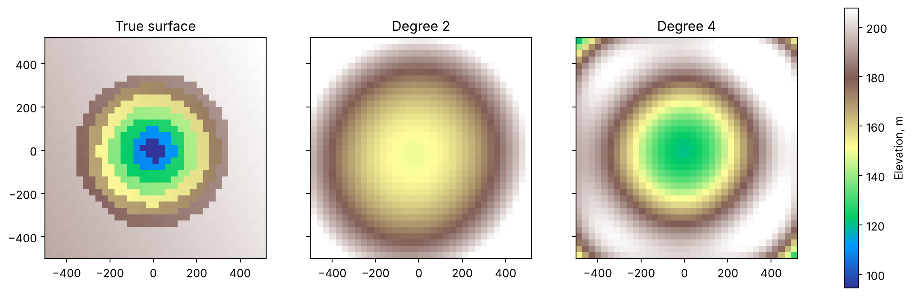

Polynomial surface and adequacy
===============================

Reproduces the polynomial-model study of Zelensky and Donchenko (2025) on the
synthetic pit: one least-squares surface per degree, each judged by the
paper's indicators. Notebook:
`notebooks/02_polynomial_surface.ipynb
<https://github.com/datasciencedynamics/pitmap/blob/main/notebooks/02_polynomial_surface.ipynb>`_,
or run it directly:

.. image:: https://colab.research.google.com/assets/colab-badge.svg
   :target: https://colab.research.google.com/github/datasciencedynamics/pitmap/blob/main/notebooks/02_polynomial_surface.ipynb
   :alt: Open in Colab

.. code-block:: python

   from pitmap import PolynomialSurface, select_degree
   from pitmap.synthetic import grid, sample_survey_points, true_surface

   xy, z = sample_survey_points(n=400, seed=0)
   ax_x, ax_y, nodes = grid(step=30.0)
   fits = {d: PolynomialSurface(degree=d).fit(xy, z) for d in range(6)}

Degree sweep
------------

RMSE is against the true surface at the grid nodes. The other columns use the
survey points only, which is all a surveyor would have.

.. list-table::
   :header-rows: 1
   :widths: 12 12 20 14 14

   * - Degree
     - R2
     - Variance ratio, %
     - Adequate
     - RMSE, m
   * - 0
     - 0.000
     - 100.0
     - no
     - 26.23
   * - 1
     - 0.027
     - 97.3
     - no
     - 25.94
   * - 2
     - 0.623
     - 37.7
     - no
     - 17.34
   * - 3
     - 0.624
     - 37.6
     - no
     - 17.35
   * - 4
     - 0.926
     - 7.4
     - yes
     - 9.55
   * - 5
     - 0.926
     - 7.4
     - yes
     - 9.48

``select_degree`` returns degree 4, the lowest that passes both thresholds,
and the RMSE column agrees. Degree 2 clears the R2 bar at 0.62 but is
rejected on the variance ratio: the surface is far flatter than the data.

The lag-1 autocorrelation of the input is near zero here because the survey
points are in random order; it is a property of the sequence, not of the fit.

Surfaces
--------

A global polynomial cannot reproduce the benches, so even the adequate fit is
far rougher than sector IDW (RMSE 9.5 m against 3.9 m). That is the expected
trade: the polynomial is a smooth trend surface, which is what the 2025 paper
uses it for, while the local interpolators follow the detail.

Reference
---------

Zelensky, O., and Donchenko, O. (2025). Mining Journal of Kryvyi Rih National
University, 59(1), 10-21. https://doi.org/10.31721/2306-5435-2025-1-10-21
