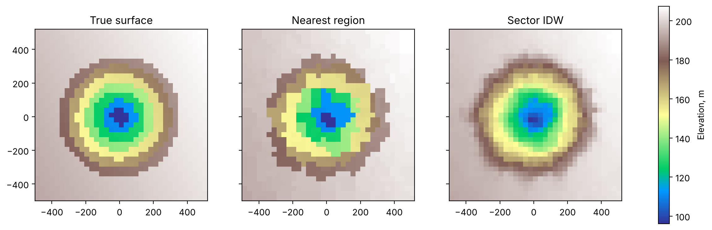
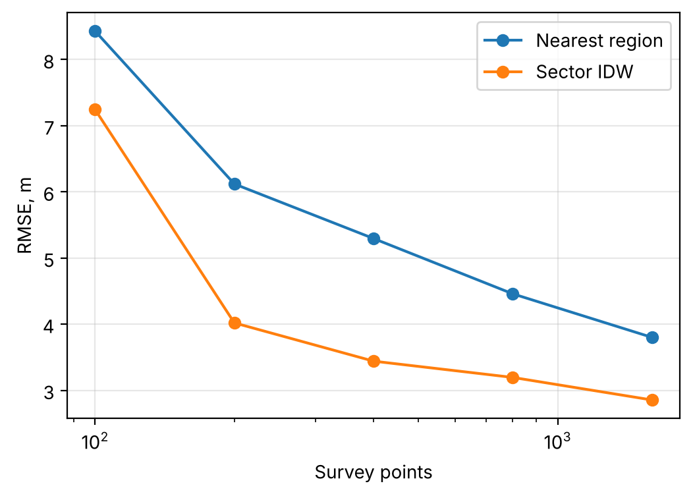

Sector IDW vs nearest region
============================

This example reproduces the experiment design of Zelenskyi et al. (2020) on a
synthetic open pit: build the surface from scattered survey points, then
measure how the error changes with the grid step and the number of survey
points. The pit is a terraced bowl with 15 m benches generated by
``pitmap.synthetic``, so the numbers below are illustrative; the paper used
real survey data from a Kryvyi Rih iron-ore quarry.

The full notebook is in the repository:
`notebooks/01_sector_idw_vs_nearest_region.ipynb
<https://github.com/datasciencedynamics/pitmap/blob/main/notebooks/01_sector_idw_vs_nearest_region.ipynb>`_.

Setup
-----

.. code-block:: python

   import numpy as np

   from pitmap import NearestRegion, SectorIDW
   from pitmap.synthetic import grid, sample_survey_points, true_surface

   xy, z = sample_survey_points(n=400, seed=0)
   ax_x, ax_y, nodes = grid(step=30.0)
   z_true = true_surface(nodes[:, 0], nodes[:, 1])

   models = {
       "Nearest region": NearestRegion(),
       "Sector IDW": SectorIDW(radius=150.0, power=2.0, n_sectors=8),
   }
   pred = {name: m.fit(xy, z).predict(nodes) for name, m in models.items()}

Surfaces on a 30 m grid
-----------------------

Nearest region reproduces the benches as flat patches whose edges follow the
survey points. Sector IDW blends across the benches, which costs some sharpness
at the bench edges but lowers the overall error.

Error vs grid step
------------------

Root-mean-square error against the true surface at the grid nodes, 400 survey
points:

.. list-table::
   :header-rows: 1
   :widths: 15 15 25 25

   * - Step, m
     - Nodes
     - Nearest region, m
     - Sector IDW, m
   * - 10
     - 10201
     - 5.92
     - 3.99
   * - 20
     - 2601
     - 5.97
     - 3.98
   * - 30
     - 1225
     - 5.78
     - 3.85
   * - 50
     - 441
     - 5.99
     - 4.06
   * - 75
     - 225
     - 5.09
     - 3.21
   * - 100
     - 121
     - 5.45
     - 4.19

Refining the grid below 30 m does not reduce the error; the survey density,
not the grid, is the limit. This is the same conclusion the 2020 paper reached
in recommending a 30 m step.

Error vs number of survey points
--------------------------------

Grid step fixed at 30 m:

Sector IDW is ahead at every density, and the gap is widest where survey
points are scarce, which is the regime that matters in practice.

Reference
---------

Zelenskyi, O. S., et al. (2020). Naukovyi Visnyk Natsionalnoho Hirnychoho
Universytetu, 6, 121-126. https://doi.org/10.33271/nvngu/2020-6/121
